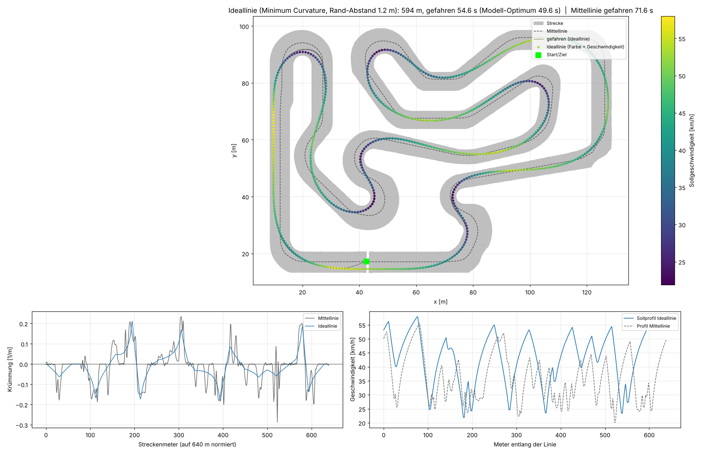

# Ideallinie als Vergleichsmassstab

**Wichtig:** Die hier berechnete Ideallinie wird **nicht** zum Training benutzt. Der RL-Agent
bekommt sie nie zu sehen – er muss die schnelle Linie selbst finden (Lidar + Kurvenvorschau,
Reward nur für Fortschritt). Die berechnete Linie dient als klassischer Vergleichsmassstab
("gelernt vs. berechnet") und als Overlay im Viewer.



## Methode

`kart_rl/raceline.py`, Werkzeug `tools/compute_raceline.py`:

1. **Minimum-Curvature-Optimierung**: Die Linie wird als seitlicher Versatz zur Mittellinie
   beschrieben, der innerhalb der Streckenränder bleiben muss (Rand-Abstand 1.2 m: halbe Kartbreite
   0.7 m plus Reserve für den Fahrer, denn kein Teil des Karts darf die Bande berühren). Die Krümmung wird um die Referenzlinie linearisiert, so dass
   "minimale Summe der quadrierten Krümmungen" ein beschränktes Least-Squares-Problem ist
   (Ansatz nach Heilmeier et al. 2019). Vier Re-Linearisierungen reichen zur Konvergenz.
2. **Geschwindigkeitsprofil** mit Reibungskreis: Kurvenlimit aus der Krümmung, Beschleunigung
   aus Motorleistung und Restgrip, Bremsen mit der Hinterradbremse (75 % nutzbar) – Vorwärts- und
   Rückwärtsdurchlauf.
3. **Fahren**: Der geskriptete Fahrer (`PurePursuitDriver`) folgt der Linie und dem Profil, mit
   Reibungskreis-Logik (bremst nicht hart, während die Reifen in der Kurve ausgelastet sind).

## Ergebnis (Race-Inn Roggwil, Kart-Modell Phase 1)

| Linie | Länge | Rundenzeit gefahren | Bemerkung |
|---|---|---|---|
| Mittellinie | 640 m | 71.6 s | einfacher Referenzfahrer |
| Ideallinie (Abstand 1.2 m) | 594 m | **54.6 s** | geskripteter Fahrer mit 80 % Grip-Nutzung |
| Ideallinie, Modell-Optimum (Abstand 0.9 m) | – | ≈ 49.6 s | Profil mit 92 % Grip, nur Schätzung |

Zielmarke für den RL-Agenten: unter 54.6 s, ideal Richtung 50 s. (Vor der Kontur-Regel, als nur der
Kart-Mittelpunkt zählte: Referenz 54.1 s, Optimum 49.8 s, Agent 50.95 s.)

```bash
python tools/compute_raceline.py            # berechnet, fährt, plottet (ca. 35 s)
python tools/compute_raceline.py --margin 1.4 --safety 0.85 --optimum-margin 0.9
```

Ausgabe: `kart_rl/data/race_inn_roggwil_raceline.json` (Punkte, Krümmung, Sollgeschwindigkeit,
Rundenzeiten) und `docs/img/raceline.png`.
