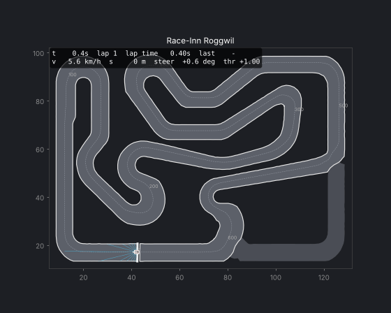

# Simulation: Kart-Modell und Umgebung (Phase 1)

## Kart-Modell (`kart_rl/kart.py`)

Dynamisches Einspurmodell mit Kart-Parametern. Die beiden Räder einer Achse werden zu einem
zusammengefasst; die Vorderachse lenkt, die Hinterachse treibt an und bremst (Mietkarts haben
nur eine Hinterradbremse). Die Reifen-Seitenkräfte sättigen weich bei `mu · Fz`, hinten mit
Reibungsellipse (viel Gas oder Bremsen = weniger Seitenführung → das Heck kann wegrutschen).

| Parameter | Wert | Bemerkung |
|---|---|---|
| Masse | 180 kg | Kart + Fahrer |
| Radstand | 1.05 m | Schwerpunkt 0.62 m vor der Hinterachse (hecklastig) |
| Gierträgheit | 45 kg·m² | |
| Max. Lenkwinkel | 0.40 rad (≈ 23°) | Lenkgeschwindigkeit max. 3 rad/s |
| Reibwert µ | 1.0 | Basis-Mischung; Phase 2 skaliert µ je nach Reifen und Verschleiss |
| Schräglaufsteifigkeit | 12 000 / 16 000 N/rad | vorne / hinten, pro Achse |
| Antrieb | 720 N, 5.3 kW | 0–50 km/h in ≈ 4.9 s |
| Bremse | 1000 N (nur hinten) | ≈ 6 m/s² |
| Luft-/Rollwiderstand | 0.48 kg/m, 0.015 | |
| Begrenzer | 18 m/s (65 km/h) | wie bei Mietkarts |

Ergebnisse des Modells: Höchstgeschwindigkeit ≈ 65 km/h, stationäre Querbeschleunigung ≈ 0.9 g,
engster Wendekreis bei vollem Einschlag ≈ 2.8 m. Integration: semi-implizites Euler mit 10 ms,
Regelschritt 50 ms (20 Hz). Unter 3 m/s wird auf ein kinematisches Modell übergeblendet, damit das
Anfahren stabil ist.

Vereinfachungen (bewusst): flache Strecke, keine Radlastverlagerung, kein Differenzial-Effekt,
keine Motor-/Kupplungsdynamik. Alle Parameter sind in `KartParams` änderbar (auch per YAML-Config).

Hooks für die späteren Phasen: `kart.grip_scale` (Reifenmischung/Verschleiss) und
`kart.power_scale` (Boost) werden pro Schritt gesetzt.

## Umgebung `KartLap-v0` (`kart_rl/envs/lap_env.py`)

Gymnasium-Umgebung (`gym.make("KartLap-v0")`), konfigurierbar über `LapEnvConfig`.

### Beobachtung (30 Werte, grob auf [-1, 1] normiert)

| Block | Werte | Beschreibung |
|---|---|---|
| Lidar | 15 | Abstand zum Streckenrand entlang 15 Strahlen über 200° (max. 30 m), normiert |
| Bewegung | 3 | Längs-/Quergeschwindigkeit, Gierrate |
| Lage | 2 | Richtungsfehler zur Mittellinie, seitlicher Versatz (relativ zur halben Breite) |
| Vorschau | 6 | Krümmung der Strecke in 5, 10, 20, 35, 50, 70 m (+ = Linkskurve) |
| Rand | 1 | Abstand der Kart-Kontur zur nächsten Bande |
| Aktuator | 1 | tatsächlicher Lenkwinkel |
| Letzte Aktion | 2 | Lenken, Gas/Bremse des Vorschritts |

### Aktion

`Box(-1, 1, (2,))`: Lenken (+ = links) und Gas/Bremse (+ = Gas, − = Bremse).

### Reward

- `+ 1.0` pro Meter Fortschritt entlang der Mittellinie (eine Runde = 640)
- `− 0.05 · (Δ Lenkbefehl)²` gegen Zickzack
- optional `reward_drift` × Grad Schwimmwinkel über `drift_threshold_deg` pro Schritt (Standard 0 = Driften erlaubt;
  Schwimmwinkel = Winkel zwischen Fahrtrichtung und Längsachse, im HUD des Viewers als «Drift» sichtbar),
- `− 20` und Episodenende bei Bandenkontakt (`off_track_mode="terminate"`, siehe unten),
  alternativ `− 20` pro Schritt ohne Abbruch (`"penalty"`)
- `− 20` und Abbruch bei > 5 s Stillstand oder > 10 m Rückwärtsfahren

Off-track heisst: der Kart-Mittelpunkt ist näher als 0.4 m am Streckenrand (oder ausserhalb).

### Episoden

- Training: Start an zufälliger Position mit zufälliger Geschwindigkeit (0–8 m/s), damit die
  ganze Strecke gleichmässig gelernt wird (`random_start=True`).
- Evaluation: stehender Start auf der Start/Ziel-Linie (`random_start=False`).
- Ende nach `laps` Zieldurchfahrten (Standard 2) oder `max_time` (150 s).
- `info` enthält `lap_times`, `current_lap_time`, `s`, `speed`, `off_track`, `clearance`, `episode_done`.

### Referenzfahrer

`kart_rl/baselines/pure_pursuit.py` ist ein geskripteter Fahrer (Pure Pursuit auf der Mittellinie,
Geschwindigkeit aus der Kurvenkrümmung). Er fährt sauber, aber langsam: **≈ 71.7 s** pro fliegende
Runde. Die RL-Agenten sollen das deutlich unterbieten (Ideallinie, später Bremsen, mehr Grip nutzen).

```bash
python scripts/play_baseline.py            # Live-Fenster
python scripts/play_baseline.py --follow   # Kamera folgt dem Kart
python scripts/play_baseline.py --gif docs/img/baseline_lap.gif --laps 1
```



### Geschwindigkeit der Simulation

Etwa 2 500 Umgebungsschritte pro Sekunde pro Prozess (ca. 2 Minuten Fahrzeit pro Sekunde Rechenzeit).
Mit 8 parallelen Umgebungen sind 1 Mio. Schritte in wenigen Minuten erreicht.

## Streckenbegrenzung (Bande)

Die Begrenzung gilt für das **ganze Kart**, nicht nur für seinen Mittelpunkt: 8 Punkte der
Kontur (1.90 × 1.40 m: vier Ecken und vier Seitenmitten) werden gegen das Streckenraster geprüft
(`wall_check: body`). Kommt einer davon näher als `off_track_margin` (0.1 m ≈ eine Rasterzelle)
an die Bande, ist das Bandenkontakt:

- `off_track_mode: terminate` (Standard): `reward_off_track` (−20) und die Episode endet. Das Kart wird
  für den letzten Frame an die Bande zurückgesetzt, es steht nie *in* der Bande.
- `off_track_mode: penalty`: Die Bande ist ein Hindernis. Das Kart wird entlang der Streckennormale
  zurück auf die Strecke geschoben, die Geschwindigkeitskomponente in die Bande wird gelöscht, der Rest
  um `wall_friction` (30 %) reduziert, und es gibt `reward_off_track` in jedem Kontakt-Schritt.
  Die Fahrt geht weiter.

Die Beobachtung «Rand» ist entsprechend der Abstand der Kontur zur Bande. `wall_check: centre` stellt
die alte Regel her (nur der Mittelpunkt zählt, früher mit `off_track_margin: 0.4`) – nur zum
Reproduzieren älterer Läufe; Modelle, die damit trainiert wurden (`phase1_long` bis 40 Mio Schritte),
schneiden unter der neuen Regel ab und müssen kurz weitertrainiert werden.
