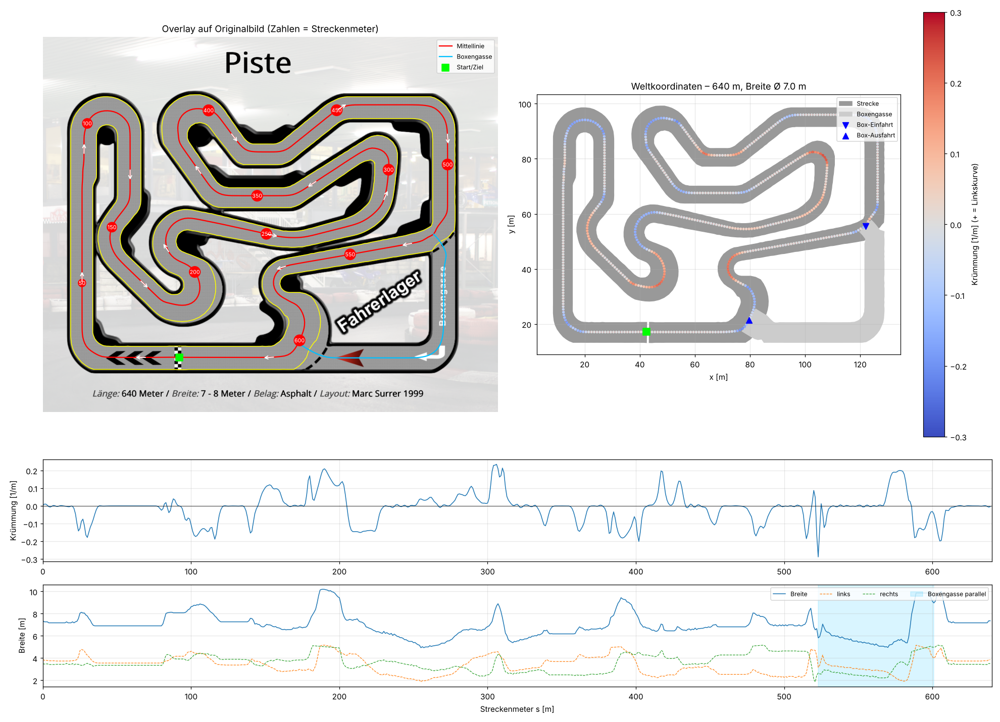

# Strecke: Race-Inn Roggwil

Indoor-Kartbahn, 640 m, 7–8 m breit, Asphalt, Layout Marc Surer (1999).
Die Streckengeometrie wurde mit `tools/extract_track.py` automatisch aus dem
Streckenplan `assets/track_map.png` extrahiert.



## Dateien

| Datei | Inhalt |
|---|---|
| `assets/track_map.png` | Original-Streckenplan (Quelle für die Extraktion) |
| `kart_rl/data/race_inn_roggwil.json` | Streckengeometrie in Metern (siehe unten) |
| `kart_rl/data/race_inn_roggwil_mask.png` | Befahrbare Fläche als Rasterbild: 0 = neben der Strecke, 255 = Strecke, 128 = Boxengasse (11.04 px/m) |
| `docs/img/track_extraction.png` | Kontrollplot der Extraktion |

## Koordinatensystem

- Weltkoordinaten in Metern, x nach Osten, y nach Norden (wie auf dem Plan, nur y-Achse umgedreht).
- Umrechnung Bildpixel → Welt: `x_m = x_px / px_per_m`, `y_m = (image_height_px − y_px) / px_per_m`.
- Fahrtrichtung: **im Uhrzeigersinn** (auf der Start/Ziel-Geraden unten nach Westen).
- Index 0 der Mittellinie = Start/Ziel-Linie. Die Streckenmeter `s` laufen in Fahrtrichtung von 0 bis 640.

## Felder in `race_inn_roggwil.json`

| Feld | Beschreibung |
|---|---|
| `centerline` | 640 Punkte `[x, y]` im Abstand von 1 m, geschlossene Schleife (letzter Punkt schliesst an Index 0 an) |
| `s` | Streckenmeter pro Punkt |
| `heading` | Fahrtrichtung in rad (0 = Osten, π/2 = Norden) |
| `curvature` | Krümmung in 1/m, **positiv = Linkskurve**; engste Kurve R ≈ 3.5 m |
| `width` | Streckenbreite in m pro Punkt (Ø 7.0 m, 4.9–10.2 m) |
| `left_edge`, `right_edge` | Streckenränder (links/rechts in Fahrtrichtung) |
| `start_finish` | Index/s der Start/Ziel-Linie |
| `pit_lane` | Boxengasse: eigene Mittellinie (83 m), Ränder, `entry_index` (s = 523 m), `exit_index` (s = 601 m); sie umgeht 78 m Strecke |
| `bounds` | Bounding-Box in Metern |
| `image_to_world` | Massstab und Bildgrösse |

## Extraktion wiederholen

```bash
python tools/extract_track.py            # Standardwerte = Race-Inn Roggwil
python tools/extract_track.py --help     # alle Parameter (Grauwerte, Start/Ziel-Pixel, Boxengassen-Hinweis, ...)
```

Ablauf: Asphalt-Grauwert maskieren → Start/Ziel-Linie überbrücken, Pfeile/Text füllen →
Skelettieren und alle Stummel entfernen → Skelett-Graph (2 Verzweigungen, 3 Pfade; der Pfad
am Boxengassen-Hinweis ist die Boxengasse) → Mittellinie glätten, in Fahrtrichtung orientieren,
bei Start/Ziel beginnen, auf 640 m skalieren → Breite links/rechts per Strahlen in der Maske
messen, Mittellinie nachzentrieren → Heading, Krümmung, Ränder → JSON + Maske + Plot.
